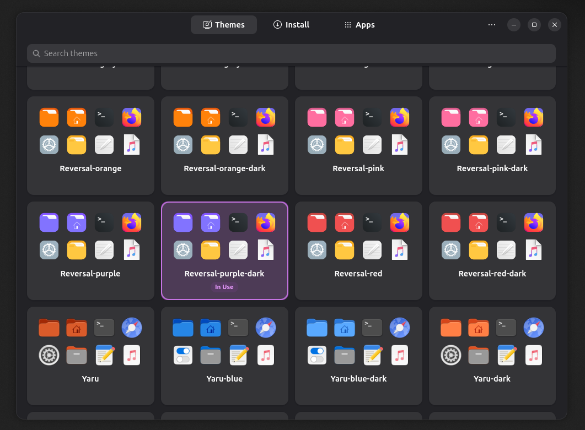
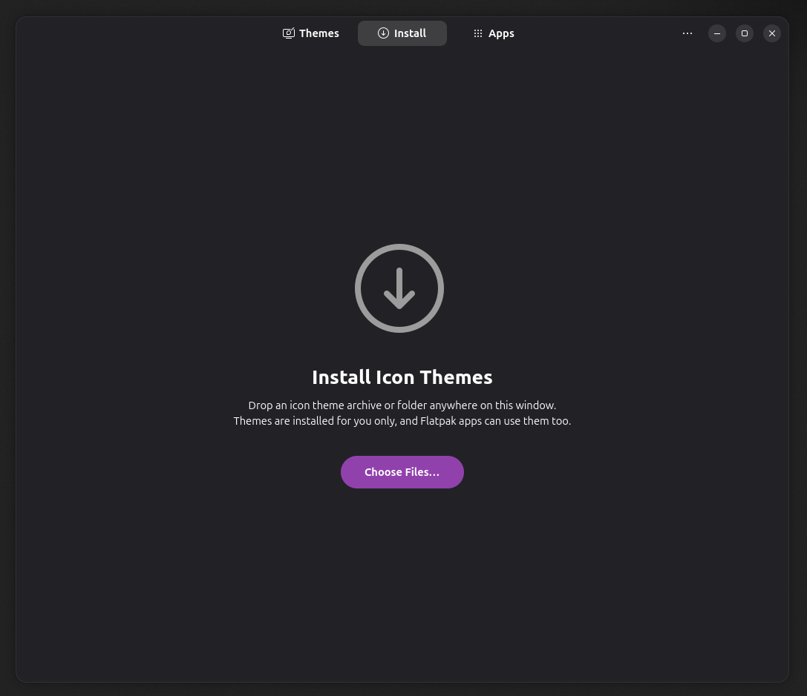
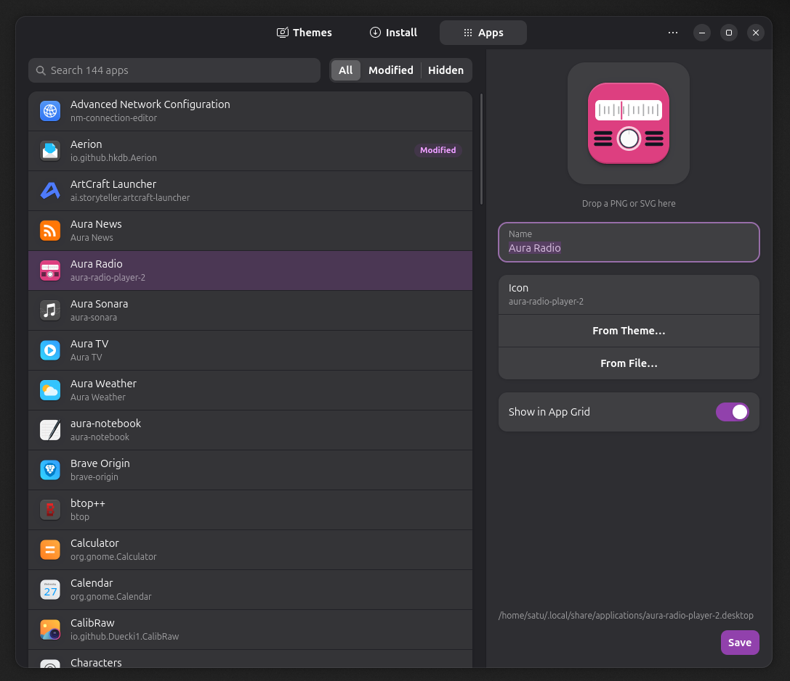

# Iconic

Change your icon theme and tidy up your app grid in GNOME.

Iconic shows every icon theme you have side by side, so you can see what they
look like before you pick one. It also lets you rename apps, give them a
different icon, or hide the ones you never use. Nothing you change touches
the apps themselves, and every change can be undone.

Built with GTK 4 and libadwaita, so it fits right in and follows your light or
dark style and accent colour.



## Pick an icon theme

Open **Themes** and click the one you like. GNOME, your apps and Flatpak apps
switch to it straight away. Type to search when the list gets long.

## Install new themes

Downloaded a theme from [GNOME Look](https://www.gnome-look.org/browse?cat=132)
or GitHub? Drop the archive (`.zip`, `.tar.gz`, `.tar.xz`…) or the unpacked
folder anywhere on the window, or open **Install** and choose the files. Iconic
finds the themes inside, installs them for you only, and offers to switch to
the new one.



Themes you installed can be removed from the Themes page with the trash button
that appears when you hover over a card.

## Change how apps look in the app grid

Open **Apps** and pick an app from the list. On the right you can:

- **Rename it**: type a new name.
- **Give it another icon**: drag a PNG or SVG straight from Files onto the
  icon, choose one from your current theme, or pick a file.
- **Hide it**: turn off *Show in App Grid*.

Press **Save** and the app grid updates. Use the *Modified* and *Hidden*
filters to find what you've changed, and **Reset** to put an app back the way
it was.



Handy tip: keep a theme's folder open in Files next to Iconic and drag icons
across one after another.

## Install

### Ubuntu and Debian

Download the `.deb` from the
[latest release](https://github.com/UnderStackDev/gnome_iconic/releases/latest)
and run:

```sh
sudo apt install ./iconic_*_amd64.deb
```

### Fedora

Download the `.rpm` from the
[latest release](https://github.com/UnderStackDev/gnome_iconic/releases/latest)
and run:

```sh
sudo dnf install ./iconic-*.x86_64.rpm
```

Iconic needs GTK 4.18 and libadwaita 1.8 or newer (Ubuntu 25.10, Fedora 43
and later).

## Keyboard shortcuts

| Key | Action |
|---|---|
| `1` `2` `3` | Themes, Install, Apps |
| Arrows, `Enter` | Pick and use a theme |
| `Ctrl+F` or `/` | Search |
| `Delete` | Remove the picked theme you installed |
| `Ctrl+O` | Choose theme files to install |
| `Enter` | Rename the picked app |
| `I` | Pick an icon from the theme |
| `Ctrl+S` | Save the app |
| `Ctrl+Z` / `Ctrl+Shift+Z` | Undo / redo |
| `Ctrl+?` | All shortcuts |

## Command line

Everything also works from a terminal, for scripts and dotfiles. Add `--json`
for machine-readable output.

```sh
iconic status
iconic list-themes
iconic apply Papirus-Dark
iconic install ~/Downloads/theme.tar.xz [--replace|--keep-both] [--apply]
iconic app list [--modified|--hidden]
iconic app set firefox --name "Web" --icon web-browser [--hide|--show]
iconic app reset firefox
```

## What Iconic changes on your system

Only files in your home folder; nothing needs administrator rights.

| Where | What |
|---|---|
| GNOME setting `org.gnome.desktop.interface icon-theme` | the icon theme |
| `~/.config/gtk-3.0`, `gtk-4.0`, `kdeglobals`, `qt5ct`, `qt6ct` | the same theme name, only if these files already exist |
| `~/.local/share/icons/` | themes you install |
| `~/.local/share/applications/` | your app changes, as a personal copy of the app's launcher |
| `~/.local/share/iconic/` | icons you picked from files, and backups |

Theme archives are checked before they're unpacked (2 GiB / 300,000 files at
most), and only files that stay inside the theme are installed.

## Building from source

```sh
cargo build --release
cargo deb --no-build          # target/debian/iconic_*.deb
cargo generate-rpm            # target/generate-rpm/iconic-*.rpm
```

Needs Rust, GTK 4 and libadwaita development files. At runtime Iconic uses
`bsdtar` (`libarchive-tools` on Ubuntu), `gtk-update-icon-cache` and
`update-desktop-database`.

For development, `cargo test` and `cargo run`. Debug builds can render the
window to a PNG, since Wayland blocks screen grabs:

```sh
ICONIC_SNAPSHOT=/tmp/shot.png ICONIC_SNAPSHOT_PAGE=apps cargo run
```

## On Omarchy?

There's a separate Iconic for Omarchy:
[UnderStackDev/omarchy_iconic](https://github.com/UnderStackDev/omarchy_iconic).

## License

MIT © 2026 UnderStackDev
